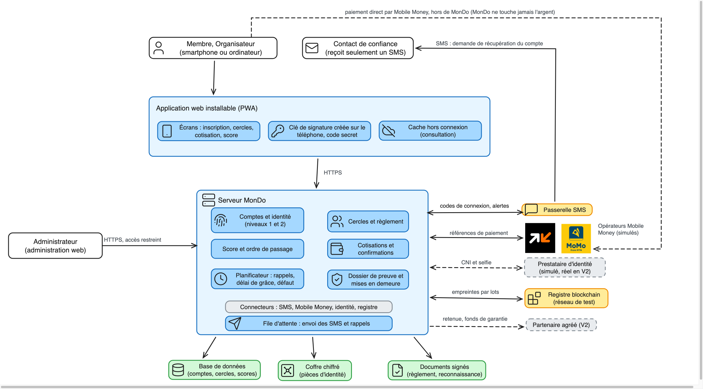

<h1 align="center">MonDo</h1>

  <strong>La tontine digitale sûre entre inconnus, au Cameroun.</strong> 
  Plus de cahier, plus de captures d'écran, plus de relances à la main : MonDo tient la tontine à ta place, et chaque membre est noté.

  
  
  
  
  
  

**MonDo ne détient jamais les fonds.** Les cotisations passent directement par Mobile Money (Orange Money, MTN MoMo) entre les membres. MonDo organise, note, rappelle et garde la preuve.

Statut : conception, avant le premier code. Le prototype vise moins d'un mois, une équipe de 5, 50 tontines et 1000 utilisateurs, avec Mobile Money et SMS simulés. Rien ici n'est un avis juridique.

## Sommaire
- [Les problèmes visés](#les-problèmes-visés)
- [Principes](#principes)
- [Architecture et choix techniques](#architecture-et-choix-techniques)
- [Feuille de route](#feuille-de-route)
- [Organisation du dépôt](#organisation-du-dépôt)
- [Sources qui font foi](#sources-qui-font-foi)
- [Décisions](#décisions)
- [Points ouverts](#points-ouverts)
- [Conventions et licence](#conventions-et-licence)

## Les problèmes visés
1. **Le défaut après la cagnotte** : un membre reçoit sa part, puis arrête de cotiser.
2. **Le cash et la gestion à la main** : cahier, captures d'écran, relances.
3. **Le cercle fermé** : on ne cotise qu'avec des gens qu'on connaît déjà.
4. **L'absence de recours légaux** : quand ça tourne mal, rien de solide à présenter. Voir [recours légaux](docs/juridique/recours-legaux.md).

## Principes
| Principe | En pratique |
|---|---|
| **Score de 0 à 100** | départ à 0, visible par les membres du cercle ; les premières places se méritent, un score trop bas ne s'achète pas. Voir [score et places](docs/conception/score-et-places.md) |
| **Deux niveaux d'identité** | numéro et nom, puis carte d'identité et selfie pour les cercles d'inconnus et pour recevoir une cagnotte |
| **Signature par clé** | créée sur le téléphone, pas par simple code SMS |
| **Registre sans fonds** | seules des empreintes sont inscrites sur la blockchain, par lots, sans donnée personnelle |
| **Dossier de preuve** | exportable pour qui voudrait agir en justice |

## Architecture et choix techniques

  

L'image est un aperçu de référence ; le schéma source est [mondo-architecture.excalidraw](docs/conception/architecture/mondo-architecture.excalidraw).

| Couche | Choix |
|---|---|
| Application mobile | React Native avec Expo |
| Administration web | React avec Vite |
| Serveur | NestJS en **monolithe modulaire** à six modules |
| Base de données | PostgreSQL, un schéma par module |
| Registre | Solidity, OpenZeppelin, Hardhat, réseau de test **Base Sepolia** |
| Langage | TypeScript partout |

Les six modules du serveur

1. Comptes et identité
2. Cercles et règlement
3. Score et ordre de passage
4. Cotisations et confirmations
5. Planificateur
6. Dossier de preuve et mises en demeure

Chaque module ne lit que ses propres tables ; les modules se préviennent par des événements internes. Voir la [décision 02](docs/conception/decision-02-monolithe-modulaire.md) et le [zoom du serveur](docs/conception/architecture/mondo-architecture-serveur.excalidraw).

## Feuille de route
| Phase | Contenu |
|---|---|
| Prototype | démonstration : 10 membres, un défaut, pénalité, exclusion des premières places au cycle suivant ; Mobile Money et SMS simulés |
| 1. Pilote sans fonds | vrais utilisateurs, MonDo ne touche pas l'argent |
| 2. Partenaire agréé | fonds de garantie et retenue sur passage, avec un partenaire agréé (règlement CEMAC 04/18) |
| 3. Extensions | passeport de crédit, assurance, diaspora |

Un avocat camerounais est requis avant tout pilote réel.

## Organisation du dépôt
| Dossier | Contenu |
|---|---|
| `docs/cadrage` | vision (PDF d'origine, version 2 en Markdown et Word), problèmes des tontines |
| `docs/conception` | décisions 01 à 03, score et places |
| `docs/conception/architecture` | architecture (Excalidraw), zoom du serveur, bibliothèque d'icônes |
| `docs/conception/userflows` | user flows au format draw.io |
| `docs/conception/cas-d-utilisation` | cas d'utilisation (Visual Paradigm) |
| `docs/business` | positionnement |
| `docs/juridique` | recours légaux, texte de la loi 2010/021 |
| `src` | code, à venir |

## Sources qui font foi
- **User flows** : `docs/conception/userflows/mondo-userflows.drawio`. Le Mermaid `docs/conception/userflows.md` et les images PNG et SVG sont gelés depuis le 27/10/2026.
- **Cas d'utilisation** : travaillés dans Visual Paradigm (`User-Case.vpp`).
- **Architecture** : `mondo-architecture.excalidraw`, à ouvrir sur excalidraw.com.
- **Vision** : version 2, [mondo-vision-v2.md](docs/cadrage/mondo-vision-v2.md) (copie gelée au 27/10/2026).

## Décisions
1. [Blockchain comme registre sans fonds](docs/conception/decision-01-blockchain-registre-sans-fonds.md)
2. [Monolithe modulaire](docs/conception/decision-02-monolithe-modulaire.md)
3. [Choix des technologies](docs/conception/decision-03-stack-technique.md) (partiellement validée)

## Points ouverts
Simulation du score, pourcentage et répartition des frais, validation juridique, maquettes d'écrans, fournisseur SMS réel, hébergement de la base, contrat Solidity ou simple horodatage pour le registre.

## Conventions et licence
Langue de travail : français. Commits `feat`, `fix`, `chore`, `docs`. Règles d'équipe : [CONTRIBUTING](CONTRIBUTING.md), [SECURITY](SECURITY.md).

Licence non définie : tous droits réservés pour l'instant. Les icônes de `mondo-icones.excalidrawlib` viennent de Lucide (licence ISC, voir `docs/conception/architecture/LICENCE-lucide.txt`).
