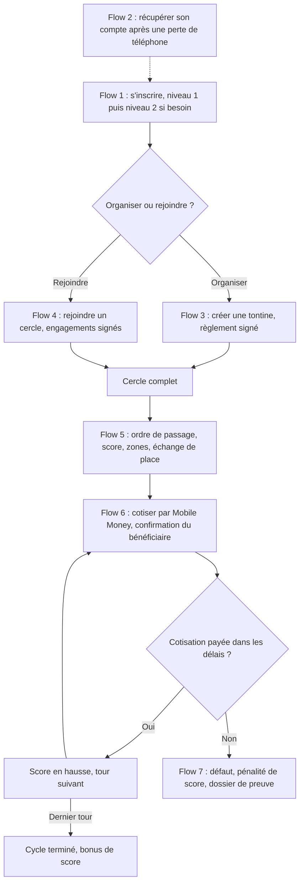
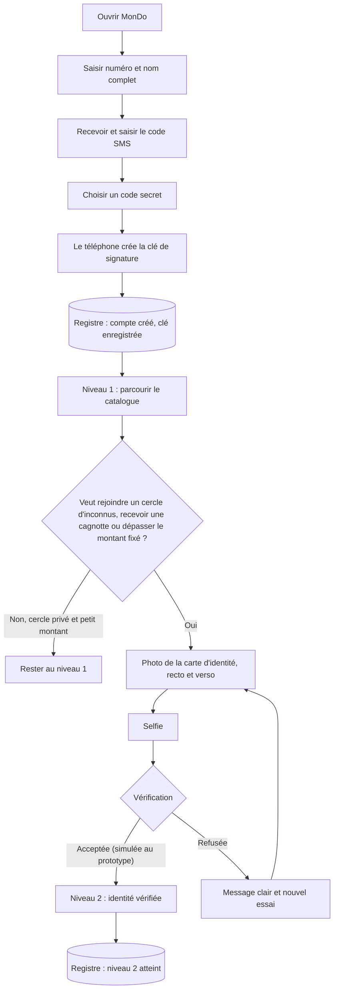
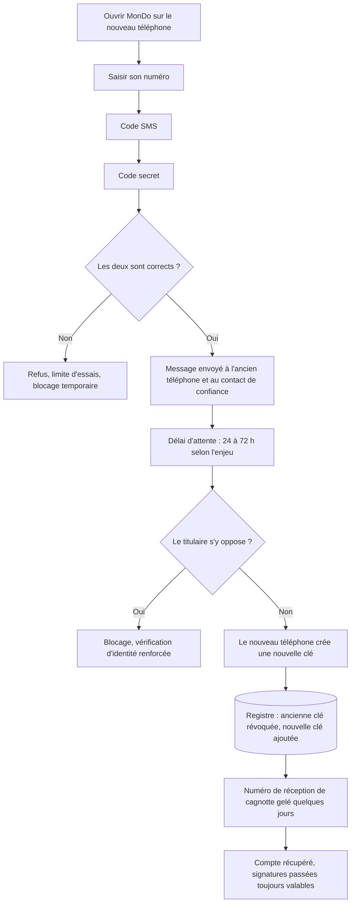
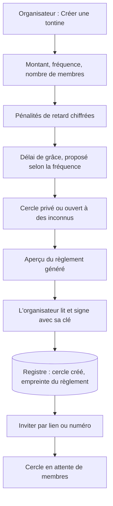
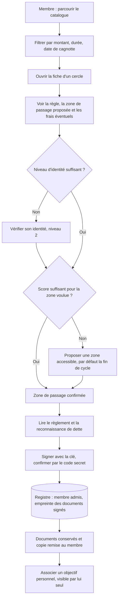
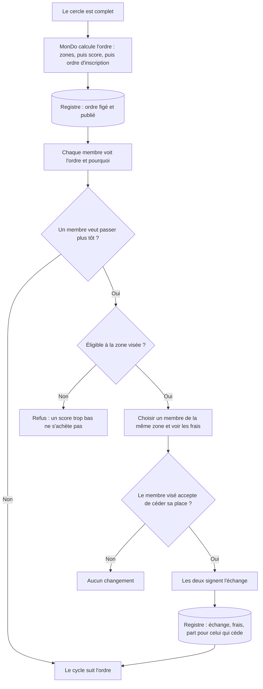
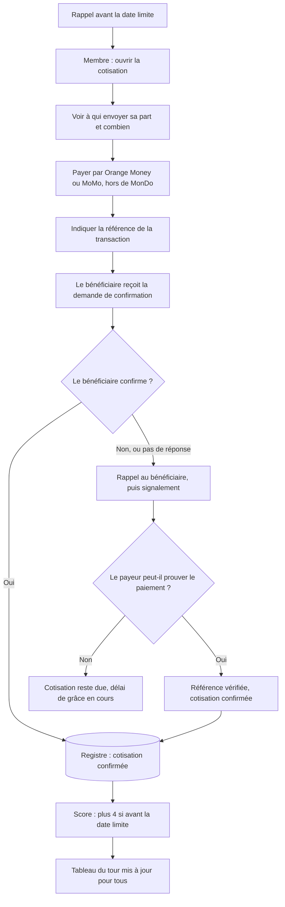
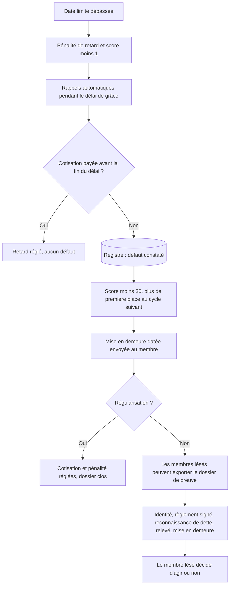

# User flows de MonDo

**Ce fichier est gelé depuis le 27/10/2026.** La source qui fait foi est `docs/conception/userflows/mondo-userflows.drawio` (draw.io, 8 pages). Ce texte Mermaid et les images PNG et SVG du dossier `userflows/` ne sont plus mis à jour : ils montrent l'état du 27/10. Toute modification des flows se fait dans le fichier draw.io.

Date : 27/10/2026. Source : user stories de `docs/cadrage/mondo-vision-v2.md`. Outil : Mermaid (texte versionné dans le dépôt, rendu en image avec mermaid-cli, vérifié dans un navigateur). Les maquettes d'écrans viendront ensuite, dans un outil de maquettage ; un user flow décrit les étapes, pas l'apparence.

Légende : rectangle = écran ou action de l'utilisateur ; losange = décision ou règle du système ; cylindre = ce que MonDo enregistre dans le registre. Les valeurs chiffrées (seuils, délais) sont des propositions de `docs/conception/score-et-places.md`.

## Vue d'ensemble : tout le parcours en un diagramme

Les sept flows détaillés suivent, un par activité des user stories.

## 1. Inscription et vérification d'identité

## 2. Récupération du compte après perte du téléphone

## 3. Créer une tontine

## 4. Rejoindre un cercle

## 5. Ordre de passage et échange de place

## 6. Cotiser

## 7. Défaut et dossier de preuve

## Points que les flows font ressortir

- **Flow 6 :** si le bénéficiaire ne répond pas, tout le tour peut se bloquer. La règle de repli (référence de transaction, délai, signalement) reste à fixer.
- **Flow 5 :** un échange de place nécessite deux signatures. Il faut décider de ce qui se passe si l'un des deux n'a plus de téléphone accessible.
- **Flow 2 :** le contact de confiance est désigné à l'inscription. Le flow 1 ne le demande pas encore : à ajouter ou à rendre facultatif.
- **Flow 7 :** les montants de pénalité et de mise en demeure sont ceux du règlement signé, pas calculés après coup (voir `docs/juridique/recours-legaux.md`).
